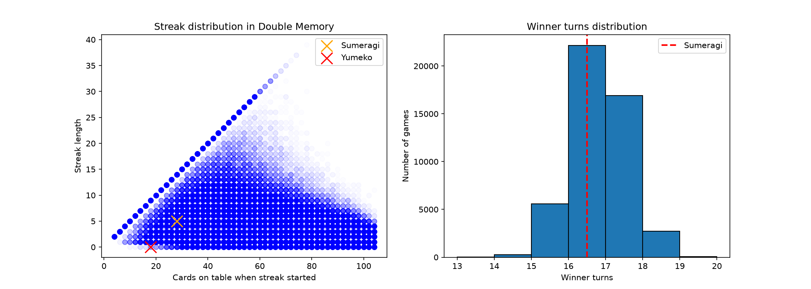

# Kakegurui-double-memory

*Spoilers for Kakegurui S1E2!*

In S1E2, Sumeragi challenges Yumeko to a game of Concentration with two decks, and calls it double memory. Both players have perfect memory.

**The Questions:** 

1. Could you tell from the stats whether Sumeragi cheated?
2. What were Yumeko's odds of winning after Sumeragi's streak ended?
   
**The METHOD** 

I simulated 50,000 games of Double Memory between two players with PERFECT memory.  Then I compared what happened in the anime to the simulated games:

- Sumeragi's streak of 5 pairs (10 cards), starting with 28 cards left
- Sumeragi winning in about 16 turns
- Yumeko's chances when she was behind 36 to 50 cards, with 18 cards left

## The Results

**1. You can't catch Sumeragi from the stats.** When a streak starts with 28 cards left, it reaches 5+ pairs about 65% of the time. Winning in about 16 turns is also completely normal. Her cheating stayed inside what honest perfect-memory play produces.

**2. Yumeko was actually the favourite!** With 18 cards left, she needed to clear the whole board in one turn. Perfect-memory players do that about **76%** of the time, so Sumeragi's "if you miss, I win" was more bluff than threat.

This chart is a bit cooked, but the labels show where both girls landed:

## Limits

- Cheaters are usually caught from patterns after a few games, not one in isolation!

This chart below is a bit cooked, but the labels tell you where both girls' odds landed in the actual anime. *NB this is my first project whoopeeeeee*

